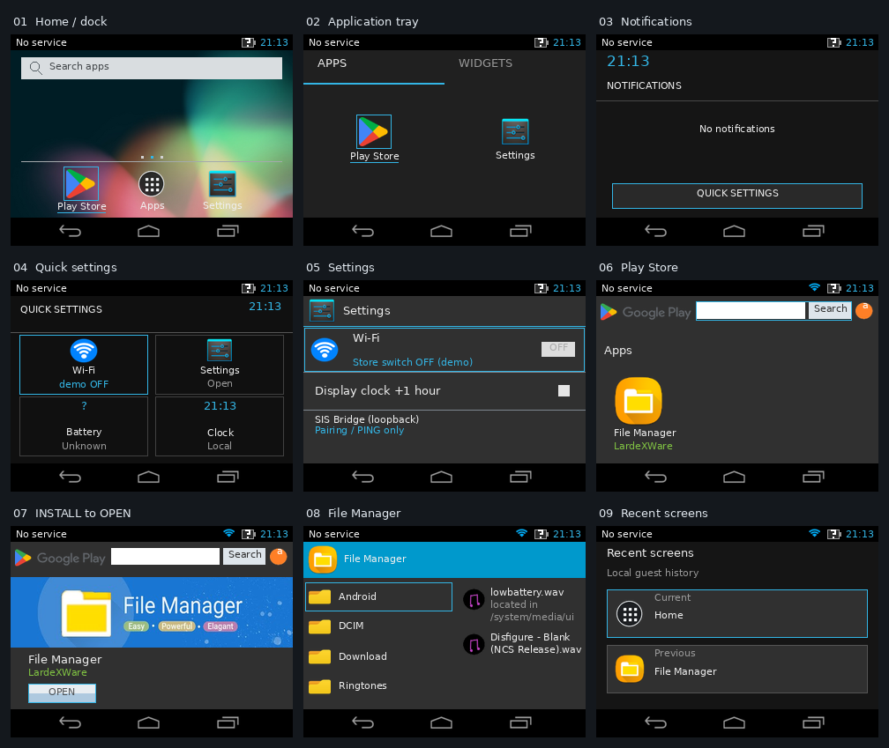
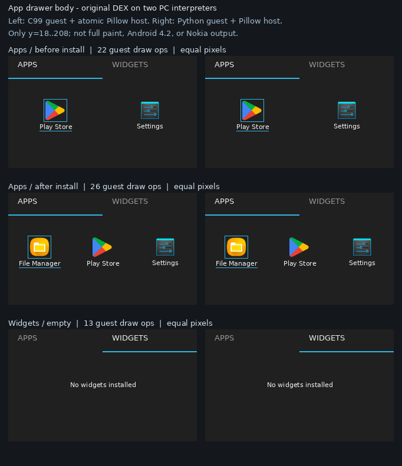
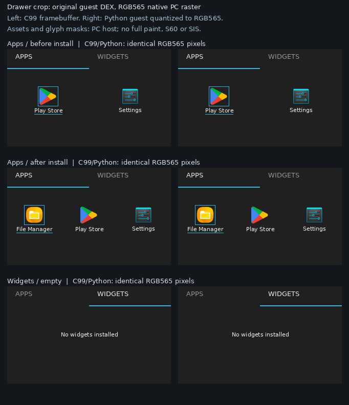
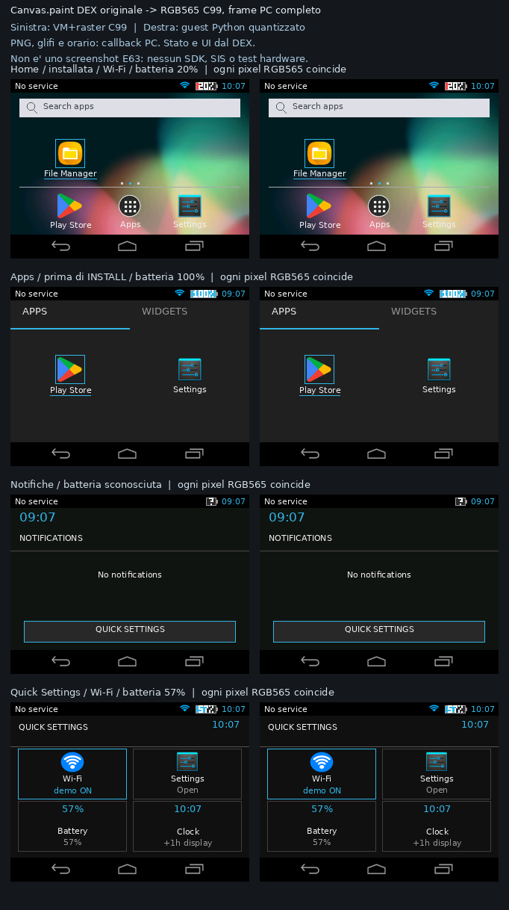

# Fedeltà visiva Android 4.2 — tappa E63 (PC)

**26 settembre 2026, ramo storico J2ME.** Questo documento riguarda **l'aspetto e la navigazione** della UI MIDP 2.0/CLDC 1.1 a 320×240, non i [sei nuovi APK con Activity Java Android](ANDROID_JAVA_E63_IT.md). Non è una dichiarazione di compatibilità con il sistema operativo Android 4.2, né una prova di funzionamento del nuovo target sul Nokia E63.

`assets/preview_android42.png` raccoglie **nove frame reali** di `E63Canvas.paint(Graphics)` eseguito dall'interprete DEX sul PC. Soltanto le didascalie e la griglia che li circondano sono disegnate dallo script host `tools/capture_android42.py`; nessuna schermata è un mockup HTML/Python. Lo script carica l'APK firmato, percorre la UI e genera di nuovo l'immagine usando uno stato temporaneo.

## Ritocchi della versione 1.2.1

- Nel guest `E63Canvas.paintQuickSettings` tutti e quattro i riquadri usano **lo stesso nero `#101010` dello sfondo**; resta il bordo ciano sul riquadro selezionato.
- `paintStatus` centra verticalmente l’orario accanto alla batteria e ne riduce la distanza orizzontale; allinea anche «No service». Continua a mostrare `?` se la batteria reale non è disponibile.
- La Home disegna la lente con `Graphics.drawArc(..., 0, 360)` (cerchio) e manico, non con un quadrato. Il servizio MIDP PC accetta soltanto quell’arco completo e rifiuta gli archi parziali non implementati.

Le modifiche sono nel **JAR 1.2.1 e nel DEX convertito di tutti e sei gli APK**; la nuova immagine completa sopra è prodotta dal guest DEX sul PC. Test del colore di tutti i riquadri, dei pixel della lente e dell’allineamento orario/batteria. L’host S60 **è stato eseguito sul telefono per Home/Fn (0.2.1)**; questa immagine resta una cattura PC: [stato renderer e SIS](PORTING_E63_STATO.md).

## Riscontro C99 aggiunto: corpo app drawer

L’interprete C99 su **PC GCC** entra nel vero `E63Canvas.paintAppDrawer(Graphics)` del J2ME convertito: il guest DEX calcola posizione, colori, testi, scelte delle icone e selezione; gli oggetti `Graphics`/`Font`/`Image` sono primitive MIDP tipizzate. Il C99 bufferizza 22 draw-op (Apps senza File Manager), 26 (Apps con stato «installed») o 13 (tab Widgets); l’host **di test** applica tutto il batch atomicamente con Pillow usando icone dell’APK. I test verificano che i pixel **della sola regione y=18..h−32**, a 320×240 e 220×180, coincidano con quelli del paint completo dello stesso DEX interpretato nella VM Python. Mutare il testo nel DEX cambia la traccia C99; fault guest/callback non mostrano frame parziali. L’immagine sopra **ritaglia il drawer**: le due colonne usano lo stesso servizio Pillow, non sono uno screenshot di un rasterizer Symbian, di Android 4.2 o dell’E63. **All'epoca di questa prova** il C99 non eseguiva `Canvas.paint`: il porting successivo rende sette schermate con status/nav. Si rigenera il crop storico con `python3 tools/capture_native_drawer.py`.

### Tappa RGB565 C99, ancora soltanto PC

**Prova storica su PC:** `symbian/runtime/rgb565_painter.c` non usa Pillow per disegnare pixel: rasterizza in C99, compone immagini/maschere e pubblica il frame **solo al successo**. I glifi in scala di grigi e PNG già decodificati erano forniti da callback PC. Sei crop Apps/Widgets a 320×240 e 220×180 sono pixel-identici alla VM Python quantizzata. Si rigenera con `python3 tools/capture_rgb565_drawer.py`. L’immagine storica NON include status/nav; il confronto nuovo qui sotto li include. Ora `e63os_app.cpp` porta lo **stesso** raster su un host Window Server GCCE con glifi e PNG dal pack SISX, ma **questa immagine resta PC e non è uno screenshot Symbian/E63**.

### Nuovo: sette percorsi `Canvas.paint` con frame interi RGB565 (PC)

`tools/capture_rgb565_full.py` verifica per **quattro scene intere a 320×240** (Home, Apps, notifiche e Quick Settings) ogni pixel del framebuffer C99 contro il vero guest DEX eseguito dalla VM Python, quantizzato RGB565. La suite prova **20 configurazioni frame-intere a 320×240 e 220×180** su sette schermate: le quattro precedenti, cartella vuota, spegnimento e Recenti. Include Apps/Widgets con stato StoreState «non installato/installato» seminato nel test (l'INSTALL end-to-end PC è provato separatamente), batteria `?` o valori di test 0/20/57/100%, Wi-Fi e ora +1h (solo nel guest). Si provano tasti/touch → metodi DEX → frame, rollback atomico, repaint ripetuti, mutazione **nel DEX** dei pixel glifo batteria inizializzati da `<clinit>`, e un eseguibile C99 isolato sotto ASan/UBSan che porta il frame a un `present_frame` **fittizio PC**. La UI (incluse status/nav e cerchio) viene scelta dal guest; callback PC forniscono solo metriche/maschere font, PNG decodificati e ora locale. Le altre schermate C99 e `startApp` **non sono implementati**; l’host S60 e due SISX sono **compilati e autofirmati**; sul dispositivo sono osservati PONG del ponte e Home/Fn della UI 0.2.1; la 0.2.2 con il fix dei tasti non è ancora provata sull’E63. Dieci ulteriori scene su PC usano proprio il pack font/PNG contenuto nel SISX e coincidono pixel per pixel con il guest Python.

## Scelte Android 4.2 realizzate nel guest

La [documentazione ufficiale Jelly Bean 4.2](https://developer.android.com/about/versions/jelly-bean#android-4.2) descrive **barra di stato superiore, barra di sistema inferiore, tendina notifiche, Quick Settings e Application Tray** su tutte le dimensioni dello schermo. Il nostro schermo E63 è **orizzontale, 320×240**: qui quelle convenzioni sono ricomposte, non replicate pixel per pixel da un Nexus.

| Elemento | Comportamento **effettivo** del guest DEX | Limite |
|---|---|---|
| Look Holo | Sfondo scuro, accento ciano `#33B5E5`, divisori sottili, icone e navigazione a tre tasti; barra di stato anche su Store/Login/File Manager **nel runtime PC**. | Il SISX renderizza sette scene soltanto. Le maschere font usano DejaVu Sans, non Roboto; Home è visibile sull’E63 ma la fedeltà pixel non è stata misurata. |
| Home | Wallpaper esistente, barra «Search apps» locale, scorciatoie Play Store/Settings, File Manager dopo l'installazione, dock e pulsante a nove punti. | La ricerca apre **solo** il catalogo locale, non Google Search. Una sola pagina Home. |
| Application Tray | Tab APPS con le app realmente disponibili nel prototipo, tab WIDGETS che indica «No widgets installed»; selezione da tastiera/touch. | Non installa o lancia app Android generiche; niente widget o paginazione reale. |
| Notifiche | Toccare la **sinistra** della barra superiore apre una tendina guest «No notifications» con accesso alle impostazioni rapide. | Non raccoglie notifiche Symbian o Android; niente gesture di trascinamento. |
| Quick Settings | Toccare la **destra** della barra superiore mostra riquadri Wi‑Fi, Settings, batteria e orologio. Wi‑Fi modifica soltanto il flag **demo** del negozio; Settings apre la schermata J2ME. L'opzione «Display clock +1 hour» cambia solo l'ora *visualizzata* nel guest. | Nessun controllo della radio, fuso orario od orologio di sistema Nokia; batteria `?`/«Unknown» se la proprietà reale non è disponibile. |
| Tasti inferiori | Back torna indietro, Home torna al launcher, Recenti apre **la cronologia locale delle schermate guest**. | Recenti non è un task manager Android né gestisce Activity. |
| Store | Ricerca, scheda e INSTALL → OPEN gestiti dal DEX J2ME **su PC**; il servizio PackageInstaller PC aggiunge `FileManager.apk` alla VFS. | Non implementato nel SISX E63. Login Google, connettività, Play Store e download online non sono reali. |

**Tastiera E63:** tasto centrale/5 = OK; **softkey fisico sinistro sotto il display** = Indietro (fix SISX 0.2.2 ancora da verificare); 0 e `*` sono scorciatoie guest per Indietro, `#` per Home. `1` = app drawer dalla Home, `3` = notifiche, `7` = impostazioni rapide, `9` = tab Widget nel drawer, `1` = tab App. Sulla QWERTY dell’E63 le cifre richiedono **Fn**; le frecce D-pad servono **solo a navigare** tra le voci, inclusa la freccia sinistra. In `web_preview.py` ci sono pulsanti equivalenti e i click vengono inoltrati come coordinate a `E63Canvas.pointerPressed` nel DEX. Sull’E63 le scorciatoie numeriche funzionano **con Fn** nella UI 0.2.1; softkey sinistro e D-pad richiedono il nuovo SISX 0.2.2 **ancora da riprovare sul telefono**.

## Tracciabilità e verifica

- Il disegno e gli handler nuovi vivono in `j2me/src/android/j2me/edition/{E63Canvas,E63Midlet}.java`, poi nel JAR e nel **vero** `classes.dex` generato con D8 8.0.40. Il nuovo `drawer.png` è un'icona originale disegnata per questo progetto, non una copia di una risorsa AOSP. Sei APK firmati v1 contengono bytecode e immagini, non schermate host precotte.
- `python3 tools/capture_android42.py` acquisisce i nove frame dallo stesso `Launcher.apk` usato dal preview. `python3 -m unittest discover -s tests -q` verifica anche nuovi pannelli, tocchi, cronologia guest, barra su Store/Login/Files, INSTALL → OPEN e parità di alcuni tasti nuovi con la **VM eventi C99**.
- `python3 tools/capture_native_drawer.py` confronta tre crop di drawer Apps/Widgets; `tests/test_native_ui_paint.py` prova anche la risoluzione 220×180, callback che rifiutano il disegno, tipi limitati e CLI C con ASan/UBSan. **78 test PC del ramo storico** superati (compresi 11 test del raster RGB565 C99); la suite globale arriva a **92** con il nuovo percorso Java APK/SISX. La parità visiva qui resta del ramo J2ME, non del nuovo SISX.
- `python3 tools/capture_rgb565_full.py` rigenera quattro coppie PC di frame interi, fallendo se anche un solo pixel RGB565 differisce; `tests/test_native_rgb565.py` copre altre schermate/stati e il CLI autonomo con ASan/UBSan.
- `python3 tools/probe_midp.py --seconds 4` conferma ancora il caricamento headless del nuovo JAR in MicroEmulator; il test non acquisisce pixel MIDP e **non simula S60v3**.

**Non fatto:** trascinamento notifiche, animazioni/densità/font identici ad Android 4.2, API Android vere, `E63Midlet.startApp` e **tutti i percorsi** di `E63Canvas.paint` nel C99, renderer font/PNG dinamico Nokia, file system `RFs`, `PackageInstaller` su E63, test hardware del softkey sinistro e del D-pad nella **UI 0.2.2**; l’utente ha già visto Home e scorciatoie Fn nella 0.2.1. **Fatto dopo la tappa PC:** SDK S60 FP1 + GCCE ottenuti, presenter Avkon/Window Server e asset pack compilati, due SISX Symbian 9 autofirmati e payload verificati, con **bridge PING e Home/Fn 0.2.1 testati sul dispositivo**, non i nuovi tasti 0.2.2; vedi [toolchain e limiti](SYMBIAN_TOOLCHAIN_IT.md). `minSdkVersion=17` nel manifest non cambia queste limitazioni. Alla data della tappa J2ME qui descritta i sorgenti Android erano consultati solo via fetch; **successivamente** l'utente ha autorizzato checkout di `frameworks/base` e 21 dipendenze AOSP indispensabili per un [nuovo runtime nativo distinto](RUNTIME_NATIVO_E63_IT.md).
